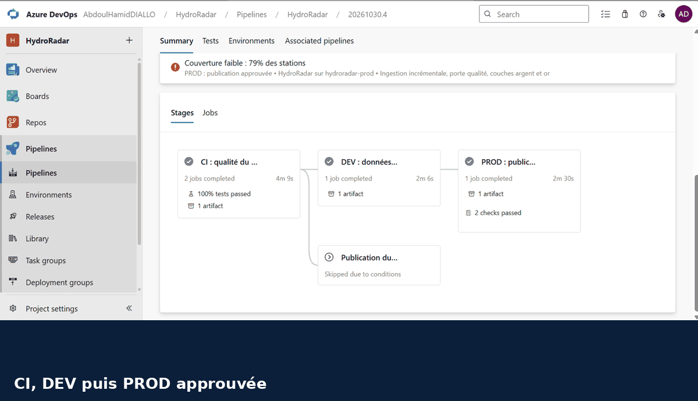
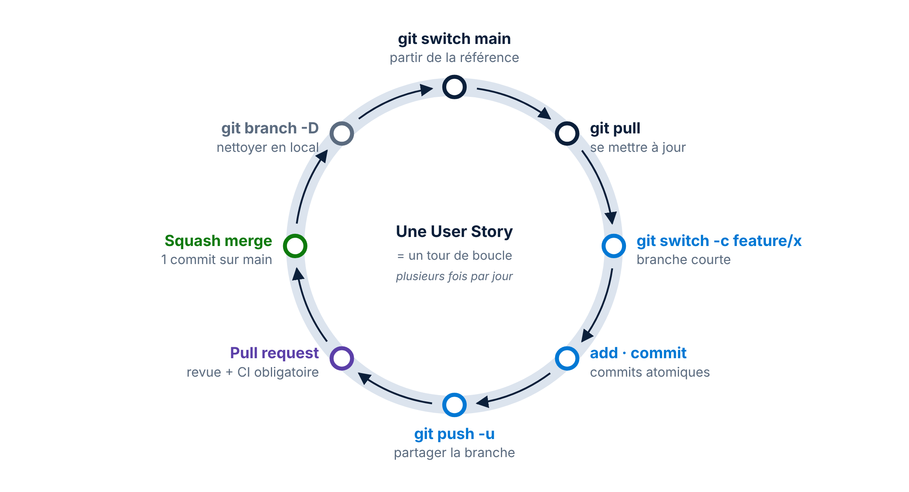
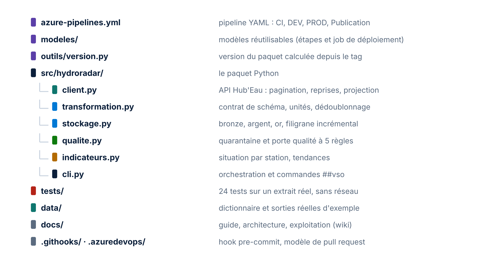

# 🌊 HydroRadar : CI/CD Azure DevOps sur les rivières en temps réel


> Un pipeline de données industrialisé de bout en bout avec **Azure DevOps**. Il charge **de façon incrémentale** les hauteurs et débits **réels** des rivières de Moselle, publiés toutes les 5 à 15 minutes par l'API **Hub'Eau Hydrométrie**, les range en couches **bronze, argent, or**, les contrôle par une **quarantaine** et une **porte qualité**, puis les déploie en **DEV** puis en **PROD après approbation**. Le traitement est un **paquet Python versionné**, publié dans **Azure Artifacts** à chaque tag. Chaque ligne de code est reliée à un work item, chaque déploiement à une approbation, chaque version à un tag. **Coût Azure : 0 €.**

| 📘 Guide pas à pas | 📄 Version PDF | 🗂️ Dictionnaire des données | ⚙️ Pipeline | 🏛️ Architecture |
|---|---|---|---|---|
| [docs/GUIDE.md](docs/GUIDE.md) | [42 pages, 12 schémas](docs/Guide_Public_DevOps_2_HydroRadar.pdf) | [data/README.md](data/README.md) | [azure-pipelines.yml](azure-pipelines.yml) | [docs/architecture.md](docs/architecture.md) |

---

## 📸 Aperçu



| Sur `main` : CI, DEV, puis PROD approuvée | Exécution réelle sur l'API Hub'Eau |
|---|---|
|  |  |
| avertissement « Couverture faible » émis par le code, PROD après 2 contrôles | 31 840 mesures, 37 stations actives sur 47, 5 règles OK |

| Paquets publiés dans Azure Artifacts | Hotfix recopié dans la release |
|---|---|
|  |  |
| `1.0.0` puis le correctif `1.0.1`, publiés par le pipeline | pull request `hotfix/user-agent-1.0` **into release/1.0** |

| Toute la hiérarchie livrée | Tableau de bord de l'équipe |
|---|---|
|  |  |
| Epic, Feature et 6 User Stories en **Closed** | historique des exécutions, tendance des tests, burndown, travail restant |

<details>
<summary><b>Voir les 19 captures réelles du projet</b></summary>

| Capture | Ce qu'elle montre |
|---|---|
| [Taskboard du Sprint 1](docs/images/captures/01_taskboard_sprint1.png) | stories et tâches dans les colonnes New, Active, Resolved, Closed |
| [Stratégie `release/*`](docs/images/captures/02_strategie_release.png) | toutes les futures branches de release protégées par motif |
| [Exécution réelle](docs/images/captures/03_execution_reelle_hubeau.png) | premier passage sur l'API, porte qualité acceptée |
| [Environnement de production](docs/images/captures/04_environnement_prod_approbation.png) | approbation obligatoire sur `hydroradar-prod` |
| [Pipeline CI, DEV, PROD](docs/images/captures/05_pipeline_ci_dev_prod.png) | les quatre stages sur `main` |
| [Paramètre sans PROD](docs/images/captures/06_parametre_sans_prod.png) | stage retiré à la compilation par `${{ if }}` |
| [Exécutions planifiées](docs/images/captures/07_executions_planifiees.png) | `cron` 8 h et 18 h en semaine |
| [Droits du flux](docs/images/captures/08_flux_droits_build_service.png) | Build Service en Feed Publisher, moindre privilège |
| [Publication 1.0.0](docs/images/captures/09_publication_1_0_0.png) | exécution nommée d'après le tag |
| [Autosquash](docs/images/captures/10_fixup_autosquash.png) | le `fixup` rangé tout seul sous son commit |
| [PR vers la release](docs/images/captures/11_pr_hotfix_vers_release.png) | correctif recopié avec `cherry-pick -x` |
| [Versions du flux](docs/images/captures/12_flux_versions.png) | 1.0.1 et 1.0.0 |
| [`git bisect log`](docs/images/captures/13_bisect_log.png) | 4 tests pour trouver le commit fautif parmi 9 |
| [Wiki](docs/images/captures/14_wiki_depuis_le_code.png) | dossier `docs` publié en wiki depuis `main` |
| [Backlog clos](docs/images/captures/15_backlog_hierarchie_close.png) | hiérarchie complète en Closed |
| [Tableau de bord](docs/images/captures/16_tableau_de_bord.png) | 4 widgets de pilotage |
| [Pipeline désactivé](docs/images/captures/17_pipeline_desactive.png) | arrêt propre, aucune exécution en file |
| [Agent hors ligne](docs/images/captures/18_agent_hors_ligne.png) | agent arrêté, toujours inscrit au pool |
| [Dernière exécution](docs/images/captures/19_pipeline_final_vert.png) | CI, DEV et PROD verts sur la dernière version de `main` |

</details>

---

## 📊 Résultats clés

| Indicateur | Valeur |
|---|---|
| Mesures réelles chargées au premier passage (Moselle, 2 jours) | **31 840** |
| Stations actives sur le référentiel | **37 sur 47** |
| Lignes en quarantaine | **0** |
| Fraîcheur de la dernière mesure | **13 minutes** |
| Règles de la porte qualité | **5**, bloquantes |
| Tests unitaires, sur un extrait **réel** de l'API | **24**, sans réseau |
| Couverture de code | **87 %** |
| Stages du pipeline | **4** : CI, DEV, PROD, Publication |
| Environnements | **2** : DEV automatique, PROD approuvée et réservée à `main` |
| Versions publiées dans Azure Artifacts | **2** : `1.0.0` et le correctif `1.0.1` |
| Work items livrés | **1** Epic, **1** Feature, **6** User Stories, **2** Bugs, sur **2** sprints |
| Situations Git pratiquées | **15** |
| Consommation Azure | **0 €** |

---

## 💼 Impact métier

- **Aucune donnée non contrôlée en production.** La porte qualité refuse tout lot suspect ; le filigrane n'avance pas, et le passage suivant relit les mêmes mesures. Les lignes impossibles partent en quarantaine sans bloquer les milliers de lignes saines.
- **Données à jour sans tout recharger.** Le chargement incrémental ne relit que le nouveau, plus 2 heures de recouvrement pour les stations en retard. Rejouer un passage ne crée aucun doublon.
- **Le même binaire partout.** Le paquet est construit une seule fois en CI, puis installé tel quel en DEV et en PROD : ce qui a été validé est exactement ce qui part en production.
- **Un correctif ne se perd jamais.** Il passe d'abord par `main`, puis il est recopié dans la release avec sa traçabilité (`cherry-pick -x`), et la version corrective est publiée.
- **Traçabilité de bout en bout.** Work item, pull request, commit, exécution, approbation, tag et paquet sont reliés : on sait qui a livré quoi, quand, et pourquoi.

---

## 🧭 Synthèse

| Brique | Ce qui est mis en place |
|---|---|
| **Azure Boards** | processus Agile : Epic, Feature, 6 User Stories estimées en Story Points, tâches avec Remaining Work, 2 Bugs, 2 sprints, requête partagée, tableau de bord |
| **Azure Repos** | `main` et `release/*` protégées par stratégie, CI obligatoire, modèle de pull request, auto-complete, fusion squash, wiki publié depuis le code |
| **Azure Pipelines** | YAML à modèles, paramètres d'exécution, `${{ if }}`, planification `cron`, variable de sortie entre stages, commandes `##vso`, tests et couverture publiés |
| **Library** | groupe `hydroradar-commun` avec une variable secrète, masquée dans les journaux |
| **Environments** | `hydroradar-dev` automatique ; `hydroradar-prod` avec approbation et contrôle de branche |
| **Azure Artifacts** | flux `hydroradar-paquets`, publication par `twine` sur tag `v*`, droits au moindre privilège |
| **Agent pools** | agent auto-hébergé Windows dans le pool `PoolLocal` |
| **Git** | trunk-based, release et hotfix, `add -p`, `fixup` et autosquash, hook `pre-commit`, `worktree`, `cherry-pick -x`, `bisect run`, archéologie |

### Ce qu'il faut créer dans Azure DevOps

| Objet | Nom | Réglage clé |
|---|---|---|
| Projet | `HydroRadar` | privé, Git, processus **Agile** |
| Itérations | `Sprint 1`, `Sprint 2` | dates réelles, sélectionnées pour l'équipe |
| Work items | Epic, Feature, 6 User Stories | Story Points, itération, tâches |
| Requête partagée | `Travail du sprint en cours` | `@CurrentIteration` + équipe, état différent de Closed |
| Stratégies de branche | `main` et le motif `release/*` | 1 relecteur, work item lié, commentaires résolus, squash seul |
| Build Validation | `CI obligatoire` | Required, sur `main` |
| Groupe de variables | `hydroradar-commun` | `racine`, `joursInitiaux`, `jetonDemo` (secret) |
| Environnements | `hydroradar-dev`, `hydroradar-prod` | PROD : Approvals + Branch control `refs/heads/main` |
| Pipeline | `HydroRadar` | fichier existant `/azure-pipelines.yml` |
| Flux | `hydroradar-paquets` | Build Service en **Feed Publisher (Contributor)** |
| Branche de release | `release/1.0` | créée depuis l'interface, tags `v1.0.0` puis `v1.0.1` |
| Wiki | `HydroRadar.wiki` | **Publish code as wiki**, dossier `/docs` de `main` |
| Tableau de bord | équipe HydroRadar | Build History, Test Results Trend, Sprint Burndown, Query Tile |


---

## ⚙️ Pipeline


| Déclencheur | CI | DEV | PROD | Publication |
|---|---|---|---|---|
| Pull request (Build Validation) | ✅ | | | |
| Push sur `main` | ✅ | ✅ | ✅ après approbation | |
| Planification, 8 h et 18 h en semaine | ✅ | ✅ | | |
| Tag `v*` | ✅ | | | ✅ |
| Manuel, production décochée | ✅ | ✅ | stage absent | |

| Stage | Ce qu'il fait |
|---|---|
| **CI** | job **Qualité** : `ruff check`, `ruff format --check`, `pytest` avec couverture, résultats publiés ; job **Paquet** : version calculée, wheel construite, artefact `paquet` |
| **DEV** | modèle `deployer.yml` : installe la wheel dans un environnement isolé, charge les données réelles, porte qualité, rapport publié |
| **PROD** | le même modèle et le même paquet, après approbation, depuis `main` uniquement |
| **Publication** | sur tag seulement : dossier de travail vidé, puis `twine upload` de la wheel exacte de l'exécution vers le flux |

| Élément du YAML | Rôle |
|---|---|
| `template:` + `parameters:` | un même job de déploiement, appelé pour DEV puis pour PROD |
| `parameters` (département, production) | formulaire au lancement, connu à la compilation |
| `${{ if eq(parameters.deployerProd, true) }}` | le stage PROD existe ou non dès la compilation |
| `$[ stageDependencies.CI.Paquet.outputs['version.numero'] ]` | la version calculée en CI est relue par les stages suivants |
| `ne(variables['Build.Reason'], 'Schedule')` | la planification rafraîchit DEV, jamais PROD |
| `env: JETON: $(jetonDemo)` | seule façon de donner un secret à un script ; il reste `***` dans les journaux |
| `##vso[task.logissue]`, `##vso[build.addbuildtag]` | avertissement « Couverture faible » et tag `qualite-acceptee` émis par le code |
| `workspace: clean: all` | l'agent auto-hébergé repart d'un dossier vide pour publier |


---

## 🔗 Lignage des données


| Étape | Module | Entrée | Sortie |
|---|---|---|---|
| Extraction | [`client.py`](src/hydroradar/client.py) | API Hub'Eau, paginée par curseur, reprises sur 429 et 5xx | liste brute de mesures |
| Bronze | [`stockage.py`](src/hydroradar/stockage.py) | réponse brute | `bronze/AAAA-MM-JJ/observations_HHMMSS.json.gz` |
| Transformation | [`transformation.py`](src/hydroradar/transformation.py) | mm et l/s, codes Sandre | contrat de schéma vérifié, m et m³/s, dédoublonné |
| Qualité | [`qualite.py`](src/hydroradar/qualite.py) | lot typé | lignes valides, quarantaine, verdict de la porte |
| Argent | [`stockage.py`](src/hydroradar/stockage.py) | lignes valides | Parquet partitionné par jour, fusion idempotente |
| Or | [`indicateurs.py`](src/hydroradar/indicateurs.py) | observations et stations | `situation_stations.csv`, `synthese.json` |
| Orchestration | [`cli.py`](src/hydroradar/cli.py) | tout ce qui précède | `etat.json`, rapport qualité, commandes `##vso` |


| Règle de la porte qualité | Seuil | Exécution réelle |
|---|---|---|
| Volume | au moins 100 mesures valides | 31 840 |
| Couverture | au moins 50 % des stations ont transmis | 78,7 % |
| Fraîcheur | dernière mesure de moins de 180 minutes | 13 min |
| Unicité | aucun doublon sur station, grandeur, date | 0 |
| Quarantaine | au plus 2 % de lignes écartées | 0 % |

**Organisation des données produites :**

```text
C:\HydroRadar\<dev|prod>\<département>\
├── etat.json                                      filigrane
├── bronze\AAAA-MM-JJ\observations_HHMMSS.json.gz  brut, immuable
├── argent\stations.parquet
├── argent\observations\date=AAAA-MM-JJ\part.parquet
├── or\situation_stations.csv · or\synthese.json
└── controle\rapport_qualite.json · controle\quarantaine.csv
```

Schéma de chaque fichier, motifs de quarantaine et réconciliation des volumes : **[data/README.md](data/README.md)**. Sorties réelles d'exemple : [`data/exemples/`](data/exemples).

---

## 🏗️ Architecture et méthode de travail

**Le parcours en 16 étapes et 6 phases**, chacune visible dans Azure DevOps :


| Phase | Étapes | Ce que vous faites | Guide |
|---|---|---|---|
| 1. Préparer | 1 à 3 | poste, exploration de l'API, projet à 0 € | [Phase 1](docs/GUIDE.md#phase-1-préparer) |
| 2. Planifier | 4 | sprints, backlog, tâches, requête partagée | [Phase 2](docs/GUIDE.md#phase-2-planifier) |
| 3. Coder | 5 à 9 | dépôt, hook, stratégies, 3 stories sur données réelles | [Phase 3](docs/GUIDE.md#phase-3-coder) |
| 4. Industrialiser | 10 à 12 | Library, environnements, pipeline à modèles | [Phase 4](docs/GUIDE.md#phase-4-industrialiser) |
| 5. Livrer | 13 | flux Artifacts, `release/1.0`, tag `v1.0.0` | [Phase 5](docs/GUIDE.md#phase-5-livrer) |
| 6. Maîtriser | 14 à 16 | journée Git d'un ingénieur, tableau de bord, arrêt | [Phase 6](docs/GUIDE.md#phase-6-maîtriser) |

**Branches : trunk-based au quotidien, release et hotfix pour la version livrée :**


**La boucle quotidienne d'une User Story :**



**Les situations Git pratiquées sur le vrai dépôt :**

| Situation | Commandes |
|---|---|
| Commiter une partie d'un fichier | `git add -p` |
| Annuler une modification locale | `git restore --staged`, puis `git restore` |
| Corriger un ancien commit | `git commit --fixup <sha>`, puis `git rebase -i main` (autosquash) |
| Refuser un commit sale avant la CI | hook `pre-commit` (`core.hooksPath .githooks`) |
| Traiter une urgence sans interrompre son travail | `git worktree add ..\HydroRadar-hotfix -b hotfix/user-agent main` |
| Relier un commit à un Bug | `#28` dans le message |
| Recopier un correctif dans la release | `git cherry-pick -x` |
| Pousser une branche issue de la release | `git push -u origin hotfix/user-agent-1.0` |
| Marquer une version | `git tag -a v1.0.1`, vérifié par `git cat-file -t` |
| Rejouer sa branche sur `main` | `git rebase origin/main` |
| Trouver le commit qui a cassé les tests | `git bisect run .venv/Scripts/python.exe -m pytest -q` |
| Retrouver quand un mot est apparu | `git log -S RECOUVREMENT` |
| Vérifier qu'un correctif est dans les deux branches | `git cherry -v main origin/release/1.0` |
| Situer une branche par rapport aux versions | `git describe --tags` |
| Unifier deux identités d'auteur | fichier `.mailmap` |


**Organisation du dépôt :**



---

## 🧰 Stack technique

| Domaine | Outils |
|---|---|
| Plateforme DevOps | Azure DevOps : Boards, Repos, Pipelines, Library, Environments, Artifacts, Wiki, Dashboards |
| Exécution | agent auto-hébergé Windows, pool `PoolLocal` |
| Langage et données | Python 3.11+, requests, pandas, pyarrow (Parquet) |
| Qualité | pytest, pytest-cov, ruff, publication JUnit et Cobertura |
| Paquet | setuptools, build, wheel, twine, SemVer |
| Gestion de version | Git : trunk-based, release, hotfix, squash, rebase, worktree, bisect |
| Source | API Hub'Eau Hydrométrie (Office français de la biodiversité, BRGM), Licence Ouverte Etalab |

### Lancer en local

```powershell
python -m venv .venv
.venv\Scripts\python.exe -m pip install -e ".[dev]"
git config core.hooksPath .githooks
.venv\Scripts\python.exe -m pytest
.venv\Scripts\hydroradar.exe --departement 57 --dossier donnees
```

Résultats dans `donnees\`, verdict dans `donnees\controle\rapport_qualite.json`. Relancez la même commande : seules les mesures nouvelles sont chargées.

### Installer le paquet depuis le flux

```powershell
pip install hydroradar==1.0.1 --index-url https://pkgs.dev.azure.com/<organisation>/HydroRadar/_packaging/hydroradar-paquets/pypi/simple/
```

### Antisèche d'entretien

| Question | Réponse courte |
|---|---|
| `${{ }}`, `$[ ]`, `$( )` ? | compilation (structure) ; exécution (conditions, sorties) ; macro avant chaque étape |
| Passer une valeur entre stages ? | `setvariable … isOutput=true` dans une étape nommée, puis `stageDependencies` |
| Un secret dans un pipeline ? | groupe de variables ou Key Vault, mappé dans `env:`, masqué `***` |
| Pourquoi des checks d'environnement ? | hors du YAML, donc impossibles à contourner en modifiant le pipeline |
| Build once, deploy many ? | un seul paquet construit en CI, installé tel quel partout |
| Agent auto-hébergé : le piège ? | son dossier survit entre exécutions : nettoyer, et publier le fichier exact |
| Artefact de pipeline ou Azure Artifacts ? | fichiers d'une exécution, ou paquets versionnés et immuables |
| Un hotfix, dans quel ordre ? | `main`, puis `cherry-pick -x` dans la release, puis tag correctif |
| worktree ou stash ? | worktree ouvre une seconde branche dans un second dossier, sans rien interrompre |
| Chargement incrémental ? | filigrane, recouvrement, fusion idempotente ; le filigrane n'avance que si le lot est accepté |
| Hauteur négative ? | normale (zéro de l'échelle) ; seul un débit négatif est rejeté |

L'antisèche complète, le glossaire et le dépannage sont en annexe du [guide](docs/GUIDE.md#annexe-a-antisèche-dentretien).

---

## ✅ Conclusion

HydroRadar réunit ce qu'une équipe data attend d'une chaîne de livraison professionnelle : une source réelle et imparfaite, un chargement incrémental idempotent, un contrôle qualité qui sait dire non, deux environnements séparés par une approbation, un paquet versionné et immuable, et un historique Git qui raconte proprement chaque décision. Le [guide](docs/GUIDE.md) permet de tout reproduire, clic par clic, avec le résultat attendu à chaque étape, puis de vivre une vraie journée d'ingénieur : documentation en cours, urgence en production, correctif livré dans deux branches, régression retrouvée en quatre tests.

---

## 💡 Le mot de la fin

> Une donnée de production n'a de valeur que si l'on peut prouver d'où elle vient, ce qui l'a contrôlée, quel code l'a produite et qui a autorisé sa mise en service. Avec Azure DevOps, cette preuve n'est plus un effort : c'est le chemin normal du travail.

**Abdoul Hamid Diallo** · Data & AI Engineer
Microsoft Certified : DP-600 · DP-700 · PL-300 · AI-102 · DP-100 · AI-900 · DP-900
[LinkedIn](https://www.linkedin.com/in/abdoul-hamid-diallo-fabric-data-engineer/) · Projet précédent : [PompeRadar](https://github.com/abdoulhamiddiallo/pomperadar-azure-devops)

Données : Hub'Eau, API Hydrométrie, Office français de la biodiversité et BRGM, Licence Ouverte Etalab.
