# 🌊 Guide HydroRadar : Azure DevOps et Git, niveau ingénieur

Ce guide reconstruit le projet de A à Z, en **16 étapes** regroupées en **6 phases**. À chaque étape : **pourquoi** on le fait, **où cliquer**, **quoi saisir** (chaque valeur est dans son propre bloc, à copier), et **ce que vous devez voir**. Tout le code se copie depuis ce dépôt : rien n'est à retaper.

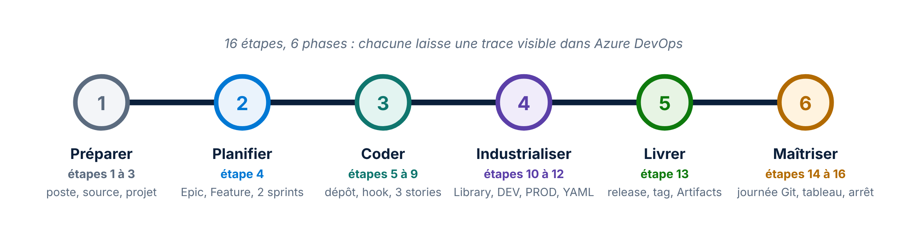

## Sommaire

- [0. Le projet en une page](#0-le-projet-en-une-page)
- [Les schémas à avoir en tête](#les-schémas-à-avoir-en-tête)
- **Phase 1. Préparer** : [Étape 1](#étape-1-préparer-le-poste) · [Étape 2](#étape-2-explorer-la-source-avant-décrire-une-ligne) · [Étape 3](#étape-3-créer-le-projet-hydroradar)
- **Phase 2. Planifier** : [Étape 4](#étape-4-planifier-deux-sprints-dans-boards)
- **Phase 3. Coder** : [Étape 5](#étape-5-cloner-le-dépôt-et-faire-le-premier-commit) · [Étape 6](#étape-6-protéger-main-et-release) · [Étape 7](#étape-7-sprint-1-story-1--le-client-hubeau) · [Étape 8](#étape-8-sprint-1-story-2--le-chargement-incrémental) · [Étape 9](#étape-9-sprint-1-story-3--qualité-indicateurs-et-données-réelles)
- **Phase 4. Industrialiser** : [Étape 10](#étape-10-le-groupe-de-variables) · [Étape 11](#étape-11-les-deux-environnements) · [Étape 12](#étape-12-sprint-2--le-pipeline-à-modèles)
- **Phase 5. Livrer** : [Étape 13](#étape-13-release-10-et-azure-artifacts)
- **Phase 6. Maîtriser** : [Étape 14](#étape-14-une-journée-dingénieur) · [Étape 15](#étape-15-le-tableau-de-bord) · [Étape 16](#étape-16-tout-arrêter--zéro-consommation)
- **Annexes** : [antisèche d'entretien](#annexe-a-antisèche-dentretien) · [glossaire](#annexe-b-glossaire) · [dépannage](#annexe-c-dépannage)

---

## 0. Le projet en une page

**Ce que vous construisez.** HydroRadar surveille en temps réel les rivières de Moselle : la Moselle à Metz, la Seille, la Sarre, la Nied… Les hauteurs d'eau et les débits **réels** arrivent de l'API publique **Hub'Eau Hydrométrie**, qui diffuse les mesures du réseau national toutes les 5 à 15 minutes. Le pipeline les charge **de façon incrémentale**, les range en couches **bronze, argent, or**, les contrôle (quarantaine et porte qualité), puis les déploie dans deux environnements, **DEV** puis **PROD**, avec un paquet Python versionné publié dans **Azure Artifacts**.

| Domaine | Ce que vous pratiquez |
|---|---|
| **Boards** | Epic, Feature, User Stories, Bugs, sprints datés, Story Points, tâches, Taskboard, requête partagée, tableau de bord |
| **Repos** | stratégies sur `main` et `release/*`, modèle de pull request, PR brouillon, auto-complete, lien `#ID`, wiki publié depuis le code |
| **Pipelines** | modèles YAML, paramètres d'exécution, `${{ if }}`, groupe de variables et secret, planification `cron`, variable de sortie entre stages, commandes `##vso`, couverture de code |
| **Livraison** | DEV automatique, PROD avec approbation et contrôle de branche, wheel versionnée, flux Azure Artifacts |
| **Git** | `add -p`, `restore`, `--fixup` et `--autosquash`, hook `pre-commit`, release et hotfix, `cherry-pick -x`, `worktree`, `bisect run`, `log -S`, `cherry`, `describe`, `.mailmap` |
| **Data engineering** | API paginée par curseur, reprises, filigrane, recouvrement, idempotence, Parquet partitionné, contrat de schéma |

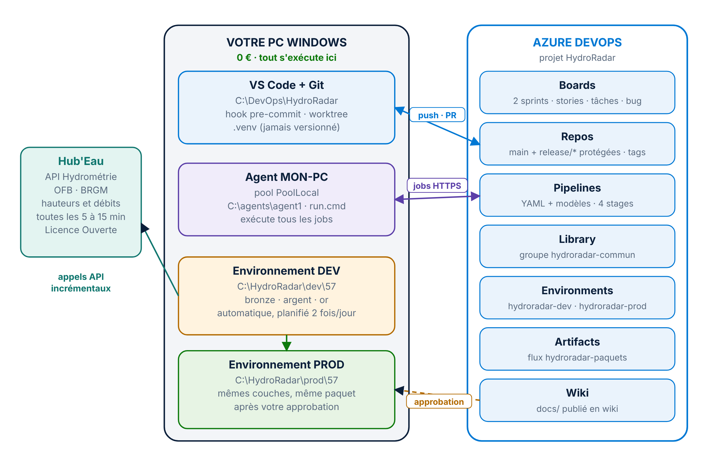

**Pourquoi le coût Azure est de 0 €.** C'est la question qu'on vous posera.
- L'organisation Azure DevOps est gratuite jusqu'à 5 utilisateurs Basic et n'exige aucun abonnement Azure.
- Tous les jobs tournent sur **votre PC**, en agent auto-hébergé : gratuit et sans limite de minutes.
- Aucune ressource Azure n'est créée. Azure Artifacts est gratuit jusqu'à 2 Gio ; le paquet pèse environ 15 Ko.

> **Si vous avez déjà fait le projet 1 ([PompeRadar](https://github.com/abdoulhamiddiallo/pomperadar-azure-devops))**, votre agent et votre pool `PoolLocal` existent déjà. Sinon, l'étape 1 explique comment les créer.

---

## Les schémas à avoir en tête

### Les couches de données et le filigrane

Un ingénieur data ne recharge jamais tout à chaque passage. Le premier passage prend deux jours d'historique. Les suivants repartent de la **dernière mesure acceptée** (le filigrane, dans `etat.json`), moins **2 heures de recouvrement**, car certaines stations transmettent en retard. Les mesures relues deux fois sont fusionnées **sans doublon** : rejouer un passage ne change rien, c'est l'**idempotence**.

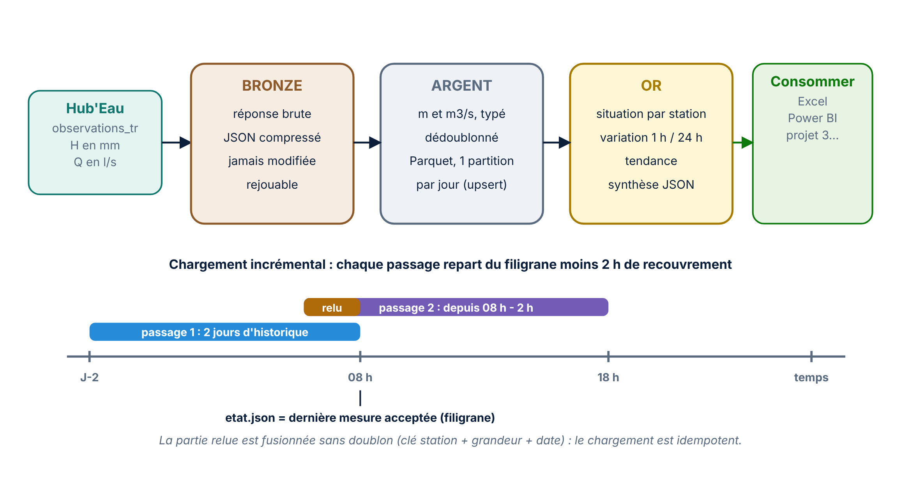

### Le travail dans Boards

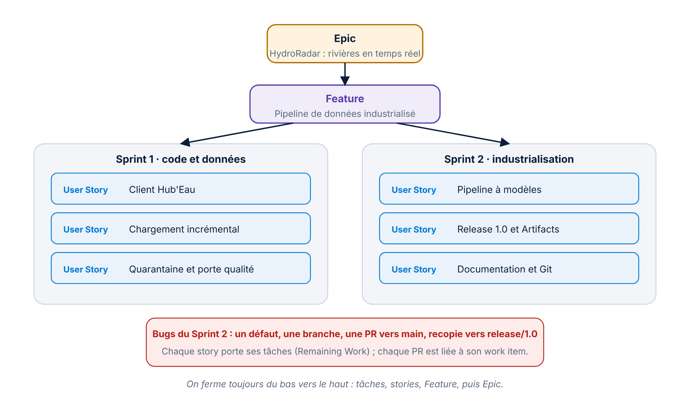

### La stratégie de branches

Au quotidien : **trunk-based**, des branches courtes vers `main`, fusionnées en squash. Quand une version est livrée, une **branche de release** la stabilise : `release/1.0`, avec le tag `v1.0.0`. Un correctif urgent passe **d'abord par `main`** (sinon il disparaîtrait à la version suivante), puis il est recopié dans la release avec `cherry-pick -x`, qui reçoit le tag `v1.0.1`.

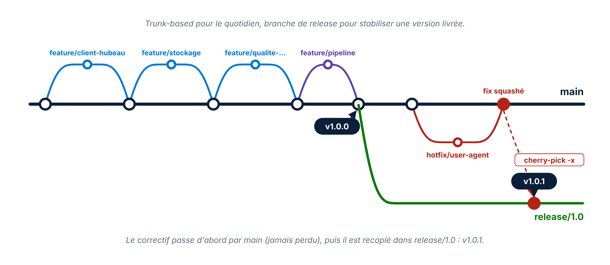

### Le pipeline

Un fichier principal et deux **modèles** réutilisables. Cinq déclencheurs, quatre stages, et des conditions qui décident ce qui tourne :

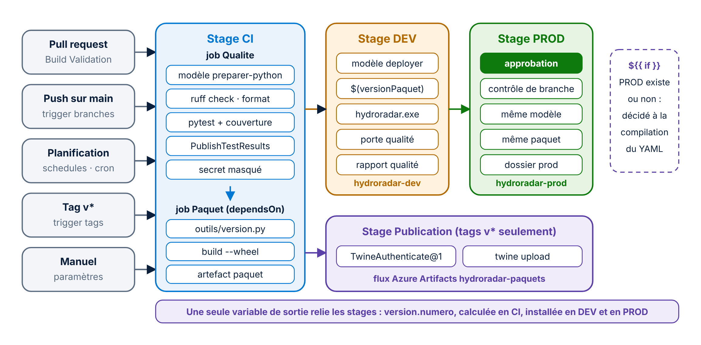

| Déclencheur | CI | DEV | PROD | Publication |
|---|---|---|---|---|
| Pull request (Build Validation) | oui | non | non | non |
| Push sur `main` | oui | oui | oui, après approbation | non |
| Planification (8 h et 18 h en semaine) | oui | oui | non | non |
| Tag `v*` (par exemple `v1.0.0`) | oui | non | non | oui |
| Manuel avec `deployerProd` décoché | oui | oui | le stage n'existe pas | non |

### La porte qualité

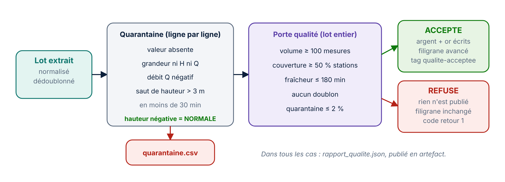

---

# Phase 1. Préparer

## Étape 1. Préparer le poste

**Pourquoi.** Git, Python, VS Code et un agent auto-hébergé : c'est tout ce qu'il faut. On ajoute les réglages Git qu'un ingénieur pose sur toute machine.

1. Dans **PowerShell**, vérifiez les outils. Il faut Git 2.37 ou plus récent et Python 3.11 ou plus récent.

```
git --version
```

```
python --version
```

```
code --version
```

2. Les réglages Git. Le premier crée tout seul la branche distante au premier `push` :

```
git config --global push.autoSetupRemote true
```

`git rebase -i` range automatiquement les commits `fixup!` :

```
git config --global rebase.autosquash true
```

Git retient vos résolutions de conflit et les rejoue si le même conflit revient :

```
git config --global rerere.enabled true
```

Les conflits affichent aussi la version d'origine commune :

```
git config --global merge.conflictstyle zdiff3
```

Des différences plus lisibles :

```
git config --global diff.algorithm histogram
```

Les chemins longs sous Windows (les environnements Python dépassent vite 260 caractères) :

```
git config --global core.longpaths true
```

Votre nom doit être **identique** à celui de votre compte Azure DevOps : les commits de fusion des pull requests portent ce nom, et deux orthographes donneraient deux auteurs dans les statistiques.

```
git config --global user.name "Prénom NOM"
```

3. **L'agent auto-hébergé.** Si vous l'avez déjà (projet 1), lancez-le dans une fenêtre PowerShell **dédiée**, que vous laisserez ouverte :

```
cd C:\agents\agent1
```

```
.\run.cmd
```

Attendu : **Listening for Jobs**. Sinon, créez-le : **Organization settings > Agent pools > Add pool**, type **Self-hosted**, nom `PoolLocal`, **Grant access permission to all pipelines** coché ; puis **New agent > Windows**, téléchargez le zip dans `C:\agents\agent1`, décompressez-le et lancez `.\config.cmd` avec l'URL de votre organisation, un jeton d'accès personnel (portée **Agent Pools : Read & manage**) et le pool `PoolLocal`.

> **À savoir.** Le jeton ne sert qu'à **enregistrer** l'agent. Une fois enregistré, l'agent a ses propres identifiants : même si le jeton expire, il continue de fonctionner.

## Étape 2. Explorer la source avant d'écrire une ligne

**Pourquoi.** On commence toujours par regarder la donnée réelle : volumes, unités, valeurs bizarres. Cinq minutes ici évitent des heures de débogage.

**Hub'Eau** est le portail des API publiques sur l'eau en France (Office français de la biodiversité et BRGM). L'API **Hydrométrie** diffuse sans clé d'accès, sous Licence Ouverte, les mesures temps réel du réseau national, avec **un mois** d'historique.

1. Le référentiel des stations en service en Moselle :

```
$base = "https://hubeau.eaufrance.fr/api/v2/hydrometrie"
```

```
$st = Invoke-RestMethod "$base/referentiel/stations?code_departement=57&en_service=true&size=100"
```

```
$st.count
```

Environ 47 stations.

```
$st.data | Select-Object code_station, libelle_station | Format-Table -AutoSize
```

2. Les dernières hauteurs de la Moselle à Metz (Pont des Morts, code `A743061001`) :

```
$obs = Invoke-RestMethod "$base/observations_tr?code_entite=A743061001&grandeur_hydro=H&size=6"
```

```
$obs.data | Select-Object date_obs, resultat_obs | Format-Table
```

3. Ce qu'il faut retenir, et que le code traitera :
- `grandeur_hydro` vaut **H** (hauteur, en **millimètres**) ou **Q** (débit, en **litres par seconde**) ;
- `date_obs` est en **UTC** ;
- une réponse **206** signifie « il reste des pages » : le lien `next` contient un **curseur** ;
- certaines hauteurs sont **négatives** : elles sont mesurées par rapport au zéro de l'échelle, ce n'est pas une erreur. Un **débit** négatif, en revanche, est impossible.

> **À savoir.** Les données de test du dépôt (`tests/donnees`) sont un **extrait réel** de cette API : 29 octobre 2026, 20 h 25 à 21 h 30 UTC, 7 stations. Les tests tournent sur du vrai, sans réseau.

## Étape 3. Créer le projet HydroRadar

1. Sur `dev.azure.com/votre-organisation`, cliquez sur **New project**. Nom :

```
HydroRadar
```

Description :

```
Surveillance des rivières en temps réel (Hub'Eau) : CI/CD multi-environnements
```

Visibility **Private** ; dans **Advanced**, Version control **Git** et Work item process **Agile** ; **Create**.

2. **Organization settings > Billing** : **Paid parallel jobs** doit rester à **0**.

---

# Phase 2. Planifier

## Étape 4. Planifier deux sprints dans Boards

**Pourquoi.** Une équipe Agile travaille en **sprints** à dates fixes. Chaque User Story est estimée en **Story Points**, découpée en **tâches**, et suivie sur le **Taskboard**.

**A. Les sprints.** **Project settings > Boards > Project configuration > Iterations**. Renommez ou créez (**...** > **New child**) deux itérations :

```
Sprint 1
```

```
Sprint 2
```

Donnez-leur des dates **qui commencent aujourd'hui** (une semaine, puis deux semaines). Les widgets de suivi et la macro `@CurrentIteration` se basent sur le calendrier : un travail rangé dans un sprint futur n'apparaît dans aucun suivi « en cours ». Vérifiez ensuite dans **Team configuration > Iterations** que les deux sprints sont sélectionnés pour l'équipe.

**B. Le backlog.** **Boards > Backlogs**, niveau **Epics**, **New Work Item** :

```
HydroRadar : rivières de Moselle en temps réel
```

Ajoutez-lui une Feature enfant (le **+** à gauche du titre) :

```
Pipeline de données industrialisé et livré
```

Au niveau **Features**, créez sous la Feature les six User Stories :

```
Client Hub'Eau et transformation des mesures
```

```
Chargement incrémental et stockage Parquet
```

```
Quarantaine, porte qualité et indicateurs
```

```
Pipeline multi-environnements à modèles
```

```
Release 1.0 et paquet dans Azure Artifacts
```

```
Documentation, wiki et journée Git
```

Ouvrez chaque story et renseignez **Story Points** et **Iteration** :

| User Story | Story Points | Iteration |
|---|---|---|
| Client Hub'Eau et transformation des mesures | 3 | Sprint 1 |
| Chargement incrémental et stockage Parquet | 5 | Sprint 1 |
| Quarantaine, porte qualité et indicateurs | 5 | Sprint 1 |
| Pipeline multi-environnements à modèles | 8 | Sprint 2 |
| Release 1.0 et paquet dans Azure Artifacts | 3 | Sprint 2 |
| Documentation, wiki et journée Git | 5 | Sprint 2 |

Critère d'acceptation de la première story (champ **Acceptance Criteria**) :

```
Le client suit la pagination par curseur, réessaie seul sur les erreurs 429 et 5xx, et les mesures sont converties en mètres et en m3/s. Tests sans réseau sur un extrait réel.
```

**C. Les tâches.** **Boards > Sprints > Sprint 1 > Backlog**. Sur la première story, **+** (Add task) :

```
Écrire le client HTTP paginé
```

```
Écrire la transformation et le contrat de schéma
```

```
Tests sur l'extrait réel
```

Dans chaque tâche, section **Effort (Hours)**, champ **Remaining** : `1`, puis **Save and Close**. Sur le **Taskboard**, les colonnes du processus Agile sont **New, Active, Resolved, Closed** : vous y glisserez les cartes au fil du travail.

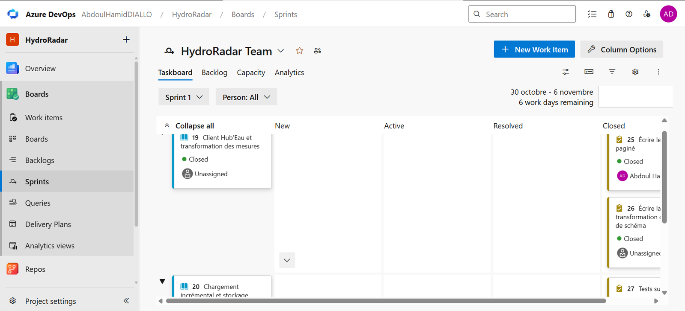

**D. Une requête partagée.** **Boards > Queries > + New query**. Réglez les clauses ainsi :

| And/Or | Field | Operator | Value |
|---|---|---|---|
| | Work Item Type | In | `User Story,Bug,Task` |
| And | State | Not In | `Closed,Removed` |
| And | Iteration Path | = | `@CurrentIteration`, puis l'équipe **HydroRadar Team** dans la seconde case |

Sans l'équipe dans la seconde case, l'éditeur affiche « Expecting team value ». **Run query**, puis **Save query** dans **Shared Queries** :

```
Travail du sprint en cours
```

> **À savoir.** `@CurrentIteration`, `@Me`, `@Today` sont des **macros** : la requête reste juste au fil des sprints. Le filtre sur l'état garde seulement le travail **restant**, ce qui rend la tuile du tableau de bord (étape 15) lisible d'un coup d'œil.

---

# Phase 3. Coder

## Étape 5. Cloner le dépôt et faire le premier commit

1. **Repos > Files**, copiez l'URL HTTPS de clonage, puis :

```
cd C:\DevOps
```

```
git clone https://votre-organisation@dev.azure.com/votre-organisation/HydroRadar/_git/HydroRadar
```

```
cd HydroRadar
```

```
code .
```

2. Copiez depuis ce dépôt GitHub les fichiers de base, au même emplacement :

| Fichier | Rôle |
|---|---|
| [`.gitignore`](../.gitignore) | ce que Git ignore |
| [`.gitattributes`](../.gitattributes) | fins de ligne normalisées (le hook garde des fins LF) |
| [`pyproject.toml`](../pyproject.toml) | dépendances, point d'entrée `hydroradar`, réglages pytest et ruff |
| [`src/hydroradar/__init__.py`](../src/hydroradar/__init__.py) | version du paquet |
| [`.azuredevops/pull_request_template.md`](../.azuredevops/pull_request_template.md) | description préremplie de chaque pull request |
| [`.githooks/pre-commit`](../.githooks/pre-commit) | refuse tout commit dont le code n'est pas propre |

Créez aussi un `README.md` minimal :

```
# HydroRadar

Hauteurs et débits des rivières en temps réel (API Hub'Eau Hydrométrie), pipeline Azure DevOps.

## Démarrage

python -m venv .venv
.venv\Scripts\python.exe -m pip install -e ".[dev]"
.venv\Scripts\hydroradar.exe --departement 57 --dossier donnees
```

> **Piège du `.gitignore`.** La ligne qui ignore les données produites est écrite `/donnees/`, avec une barre **au début**. Sans elle, Git ignorerait **tous** les dossiers nommés `donnees`, y compris `tests/donnees`, et la CI échouerait faute de données de test. Pour savoir quelle règle ignore un fichier : `git check-ignore -v chemin/du/fichier`.

3. L'environnement Python, en mode **éditable** (le paquet pointe vers vos sources) :

```
python -m venv .venv
```

```
.venv\Scripts\python.exe -m pip install --upgrade pip
```

```
.venv\Scripts\python.exe -m pip install -e ".[dev]"
```

4. Activez le hook (réglage local, à refaire à chaque clone) :

```
git config core.hooksPath .githooks
```

5. Le premier commit, directement sur `main` (la protection n'existe pas encore) :

```
git add .
```

```
git commit -m "chore: initialisation du dépôt HydroRadar"
```

Vous voyez `pre-commit : OK`. Si le hook refuse pour un problème de mise en forme, lancez la commande qu'il affiche (`ruff format .`), refaites `git add .` et le commit.

```
git push
```

> **Réglez VS Code** pour éviter les refus du hook : **File > Preferences > Settings**, cherchez `insert final newline` et cochez **Files: Insert Final Newline**.

## Étape 6. Protéger main et release/*

1. **Repos > Branches**, ligne `main`, **...** > **Branch policies** :
- **Require a minimum number of reviewers** : `1`, avec **Allow requestors to approve their own changes** coché (indispensable si vous êtes seul) ;
- **Check for linked work items** : **Required** ;
- **Check for comment resolution** : **Required** ;
- **Limit merge types** : seulement **Squash merge**.

La **Build Validation** viendra à l'étape 12.

2. **Une stratégie pour toutes les futures branches de release.** **Project settings > Repos > Repositories > HydroRadar**, onglet **Policies**, section **Branch Policies**, **+**, **Protect current and future branches matching a specified pattern** :

```
release/*
```

**Create**, puis activez les mêmes règles que pour `main`.

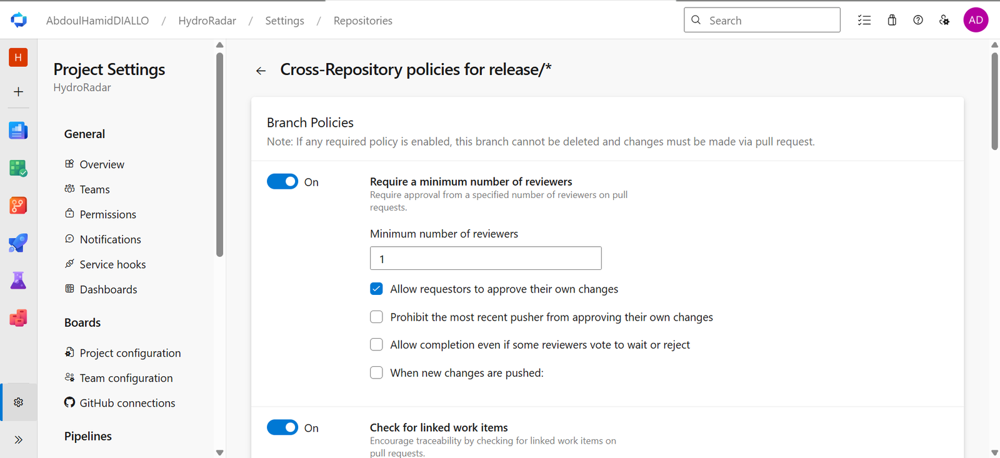

> **À savoir.** On protège par **motif**, jamais branche par branche. En entretien : « `main` et `release/*` sont protégées par stratégie ; on n'y pousse jamais en direct ».

## Étape 7. Sprint 1, story 1 : le client Hub'Eau

**Pourquoi.** L'accès à la source est isolé dans un client dédié : pagination, reprises et découpage des requêtes sont testés une fois pour toutes.

1. Une branche depuis un `main` à jour :

```
git switch main
```

```
git pull
```

```
git switch -c feature/client-hubeau
```

Sur le **Taskboard**, glissez la tâche **Écrire le client HTTP paginé** de **New** vers **Active**.

2. Copiez [`src/hydroradar/client.py`](../src/hydroradar/client.py). Retenez trois idées : la session `Retry` (5 reprises, attente croissante, sur 429 et 5xx), la boucle `while url` qui suit `next`, et le découpage en lots de 50 stations.

> **Pour pratiquer le hotfix de l'étape 14**, écrivez la ligne du User-Agent avec une version **figée** et supprimez la ligne `from hydroradar import __version__` :
> ```
>     session.headers["User-Agent"] = "HydroRadar/1.0 (projet Azure DevOps)"
> ```

```
git add src/hydroradar/client.py
```

```
git commit -m "feat(client): client Hub'Eau paginé avec reprises automatiques"
```

3. Copiez [`src/hydroradar/transformation.py`](../src/hydroradar/transformation.py) :

```
git add src/hydroradar/transformation.py
```

```
git commit -m "feat(transformation): contrat de schéma, unités et dédoublonnage"
```

4. Copiez les données de test réelles [`tests/donnees/`](../tests/donnees), puis [`tests/conftest.py`](../tests/conftest.py), [`tests/test_client.py`](../tests/test_client.py) (sans son **dernier** test, `test_le_user_agent_porte_la_vraie_version`, qui viendra avec le hotfix) et [`tests/test_transformation.py`](../tests/test_transformation.py).

```
.venv\Scripts\python.exe -m pytest
```

Attendu : `8 passed`.

```
git add tests
```

```
git commit -m "test: tests du client et de la transformation sur extrait réel"
```

5. Poussez et ouvrez la pull request en **brouillon** :

```
git push
```

Dans Azure DevOps, **Create a pull request**. Titre :

```
Client Hub'Eau et transformation des mesures
```

La description est préremplie par le modèle : **remplissez-la vraiment**. En fusion squash, **elle devient le message du commit sur `main`**, pour toujours. Liez la User Story, puis la **flèche à droite de Create** > **Create as draft**. Relisez l'onglet **Files**, puis **Publish**.

6. **Set auto-complete** : **Squash commit**, **Delete feature/client-hubeau after merging**, **Complete associated work items after merging**. Puis **Approve** : la PR se termine seule dès que les stratégies sont satisfaites.

7. Glissez les tâches dans **Closed**, puis :

```
git switch main
```

```
git pull
```

```
git branch -D feature/client-hubeau
```

> **À savoir.** `-D` et non `-d` : un squash crée un **nouveau** commit sur `main`, donc Git ne reconnaît pas les commits de la branche comme fusionnés. Avec un workflow squash, `-D` est normal.

## Étape 8. Sprint 1, story 2 : le chargement incrémental

**Pourquoi.** Le cœur du data engineering : ne charger que le nouveau, sans jamais créer de doublon, même si un passage est rejoué.

```
git switch -c feature/stockage
```

Copiez [`src/hydroradar/stockage.py`](../src/hydroradar/stockage.py) et [`tests/test_stockage.py`](../tests/test_stockage.py). Quatre décisions à savoir expliquer :
- **filigrane avec recouvrement** : relire 2 h en arrière, car une station en retard peut livrer une mesure antérieure au filigrane ;
- **upsert par partition** : seule la partition du jour concerné est relue et réécrite ;
- **idempotence** : dédoublonnage sur la clé station, grandeur, date ;
- **élagage de partitions** : `lire_observations` n'ouvre que les dossiers `date=` utiles.

```
.venv\Scripts\python.exe -m pytest
```

Attendu : `13 passed`.

```
git add src/hydroradar/stockage.py tests/test_stockage.py
```

```
git commit -m "feat(stockage): filigrane, upsert idempotent et Parquet partitionné"
```

```
git push
```

PR, titre :

```
Chargement incrémental et stockage Parquet
```

User Story liée, auto-complete, **Approve**, puis `git switch main`, `git pull`, `git branch -D feature/stockage`.

## Étape 9. Sprint 1, story 3 : qualité, indicateurs et données réelles

```
git switch -c feature/qualite-indicateurs
```

1. Copiez [`qualite.py`](../src/hydroradar/qualite.py), [`indicateurs.py`](../src/hydroradar/indicateurs.py), [`cli.py`](../src/hydroradar/cli.py) et [`__main__.py`](../src/hydroradar/__main__.py), puis [`tests/test_qualite.py`](../tests/test_qualite.py) et [`tests/test_indicateurs.py`](../tests/test_indicateurs.py).

Dans `cli.py`, les lignes qui commencent par `##vso[` sont des **commandes de journalisation** : l'agent les intercepte pour créer une variable, un avertissement ou un tag d'exécution.

```
.venv\Scripts\python.exe -m pytest
```

Attendu : `21 passed`.

2. **Premier passage sur les données réelles**, en local :

```
.venv\Scripts\hydroradar.exe --departement 57 --dossier donnees
```

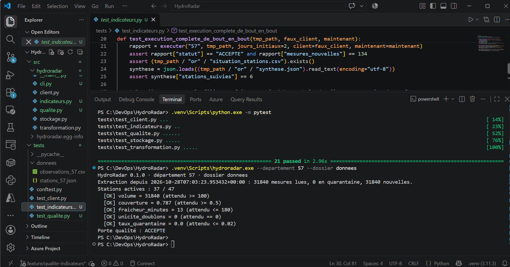

Ci-dessus, une exécution réelle : **31 840 mesures** lues sur deux jours, 37 stations actives sur 47, aucune quarantaine, les cinq règles **OK**.

3. Relancez **immédiatement** la même commande : l'extraction repart du filigrane moins 2 h, quelques centaines de mesures sont lues et **presque aucune n'est nouvelle**. C'est l'incrémental et l'idempotence, en vrai.

4. Explorez le résultat :

```
explorer donnees
```

`or\situation_stations.csv` s'ouvre dans Excel, `controle\rapport_qualite.json` donne le verdict, `etat.json` le filigrane. Le détail de chaque fichier est dans le [dictionnaire des données](../data/README.md).

5. Commit, push, PR :

```
git add src tests
```

```
git commit -m "feat: quarantaine, porte qualité, indicateurs et point d'entrée"
```

```
git push
```

PR :

```
Quarantaine, porte qualité et indicateurs
```

Le Sprint 1 est terminé : ses trois stories sont **Closed**.

---

# Phase 4. Industrialiser

## Étape 10. Le groupe de variables

**Pourquoi.** Les réglages partagés (chemins, seuils, secrets) ne s'écrivent pas en dur dans le YAML : ils vivent dans la **Library**, modifiables sans commit et protégés par des permissions.

**Pipelines > Library > + Variable group**. Nom :

```
hydroradar-commun
```

Trois variables (**+ Add**) :

| Nom | Valeur |
|---|---|
| `racine` | `C:\HydroRadar` |
| `joursInitiaux` | `2` |
| `jetonDemo` | `ceci-est-un-secret-de-demonstration` |

Sur `jetonDemo`, cliquez le **cadenas** : la variable devient **secrète**. **Save**.

> **À savoir.** Un secret n'est **jamais** transmis automatiquement à un script : il faut le mapper dans `env:`. En entreprise, le groupe est relié à **Azure Key Vault**, et la rotation se fait dans le coffre.

## Étape 11. Les deux environnements

**Pourquoi.** DEV reçoit tout automatiquement. PROD n'est servie qu'après **deux contrôles** : une approbation humaine, et la garantie que le code vient de `main`.

1. **Pipelines > Environments > New environment**, Resource **None** :

```
hydroradar-dev
```

```
hydroradar-prod
```

2. Dans **hydroradar-prod**, **...** > **Approvals and checks** > **+** > **Approvals** : vous comme approbateur, avec l'approbation de vos propres exécutions autorisée. Instructions :

```
Vérifier l'artefact controle-hydroradar-dev (statut ACCEPTE) avant d'approuver.
```

3. Encore **+** > **Branch control**, Allowed branches :

```
refs/heads/main
```

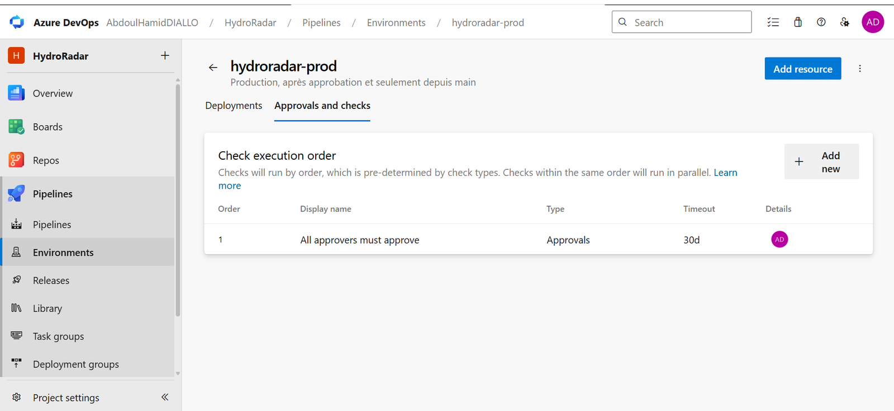

> **À savoir.** Les contrôles d'environnement sont **hors du YAML** : un développeur ne peut pas les contourner en modifiant le pipeline. Autres contrôles utiles : **Business hours**, **Exclusive lock**, **Invoke REST API**.

## Étape 12. Sprint 2 : le pipeline à modèles

**Pourquoi.** On factorise avec des **modèles** : `preparer-python.yml` (des étapes) et `deployer.yml` (un job complet, appelé deux fois avec des paramètres différents). C'est ainsi qu'on maintient des dizaines de pipelines.

```
git switch main
```

```
git pull
```

```
git switch -c feature/pipeline
```

1. Copiez [`outils/version.py`](../outils/version.py), [`tests/test_version.py`](../tests/test_version.py), [`modeles/preparer-python.yml`](../modeles/preparer-python.yml), [`modeles/deployer.yml`](../modeles/deployer.yml) et [`azure-pipelines.yml`](../azure-pipelines.yml).

```
.venv\Scripts\python.exe -m pytest
```

Attendu : `23 passed`.

2. Ce qu'il faut comprendre dans le YAML :

| Élément | Rôle |
|---|---|
| `tags: include: v*` | pousser un tag `v1.0.0` déclenche le pipeline |
| `schedules` + `cron: '0 7,17 * * 1-5'` | 7 h et 17 h **UTC** en semaine ; `always: true` lance même sans nouveau commit |
| `parameters` | formulaire au lancement manuel, connu **à la compilation** |
| `- group: hydroradar-commun` | importe les variables de la Library |
| `template:` + `parameters:` | insère un modèle avec ses valeurs |
| `name: version` + `isOutput=true` | la variable `version.numero` sort du job Paquet |
| `$[ stageDependencies.CI.Paquet.outputs['version.numero'] ]` | DEV, PROD et Publication relisent cette version |
| `${{ if eq(parameters.deployerProd, true) }}` | le stage PROD existe **ou non** dès la compilation |
| `ne(variables['Build.Reason'], 'Schedule')` | la planification rafraîchit DEV, jamais PROD |
| `env: JETON: $(jetonDemo)` | le seul moyen de donner un secret à un script |
| `workspace: clean: all` + nom exact de la wheel | la publication n'envoie que **le** paquet de cette exécution |

> **Les trois syntaxes de variables, question d'entretien n° 1.** `${{ }}` à la **compilation** (structure, modèles, paramètres) ; `$[ ]` à l'**exécution**, avant le job (conditions, variables de sortie) ; `$( )` **macro** remplacée juste avant chaque étape.

3. Commit et push :

```
git add outils tests/test_version.py modeles azure-pipelines.yml
```

```
git commit -m "ci: pipeline multi-environnements à modèles, paquet versionné"
```

```
git push
```

4. **Créer le pipeline.** **Pipelines > New pipeline > Azure Repos Git > HydroRadar > Existing Azure Pipelines YAML file**, branche `feature/pipeline`, chemin `/azure-pipelines.yml`, **Continue**, **Run**. Au bandeau **This pipeline needs permission to access 2 resources** : **View > Permit**.

5. Suivez l'exécution : **CI** vert ; DEV, PROD et Publication **Skipped** (ni `main`, ni tag). Explorez l'onglet **Tests**, l'onglet **Code Coverage**, et le journal de **Démonstration : un secret reste masqué** (la valeur est remplacée par `***`).

6. **Brancher la CI sur `main`.** **Repos > Branches > main > Branch policies > Build Validation > +**, pipeline **HydroRadar**, Policy requirement **Required**, nom :

```
CI obligatoire
```

7. PR :

```
Pipeline multi-environnements à modèles
```

User Story liée, auto-complete, **Approve**. La fusion déclenche le pipeline complet :
- **DEV** installe la wheel dans `C:\HydroRadar\dev\57\.venv`, charge deux jours de mesures réelles et passe la porte qualité ;
- un **avertissement** « Couverture faible » apparaît si moins de 80 % des stations ont transmis, et le **tag** `qualite-acceptee` s'affiche en haut de l'exécution ;
- **PROD** attend : ouvrez l'artefact `controle-hydroradar-dev`, lisez `rapport_qualite.json`, puis **Review > Approve**.

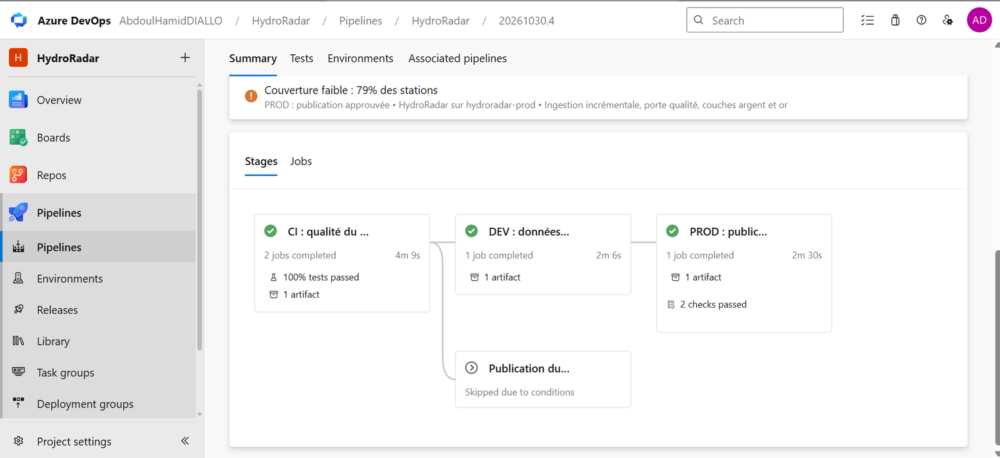

8. **Exécution manuelle avec paramètres.** **Run pipeline**, Département **54**, décochez **Inclure le déploiement en production**. Le stage PROD **n'existe pas** dans le graphe : il a été retiré à la compilation.

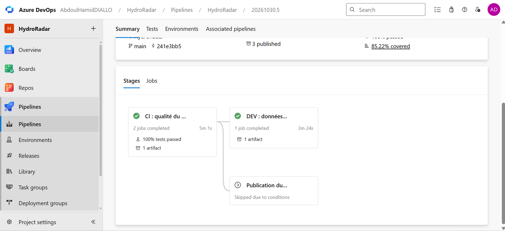

9. **La planification.** **Pipelines > HydroRadar > ...** > **Scheduled runs** : les heures sont affichées dans votre fuseau. En hiver, `7,17` UTC donne 8 h et 18 h à Paris ; en été, 9 h et 19 h (le cron ne suit pas l'heure d'été).

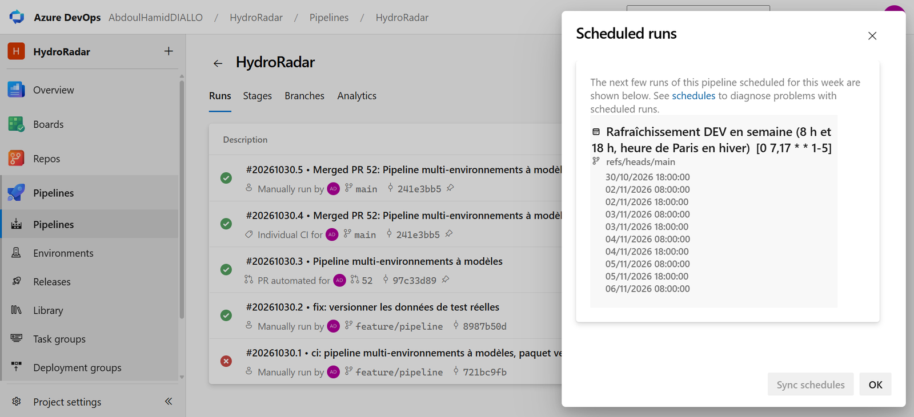

10. **L'onglet Stages** du pipeline montre, pour chaque environnement, **quelle exécution** y est passée en dernier. « DEV est vert » ne veut pas dire « c'est livré » : c'est l'exécution passée par **PROD** qui compte.

```
git switch main
```

```
git pull
```

```
git branch -D feature/pipeline
```

---

# Phase 5. Livrer

## Étape 13. Release 1.0 et Azure Artifacts

**Pourquoi.** Un pipeline de données produit aussi du **logiciel** : le paquet `hydroradar`. On le versionne selon **SemVer** (MAJEUR.MINEUR.CORRECTIF) et on le publie dans un **flux** privé, d'où toute l'organisation peut l'installer avec `pip`.

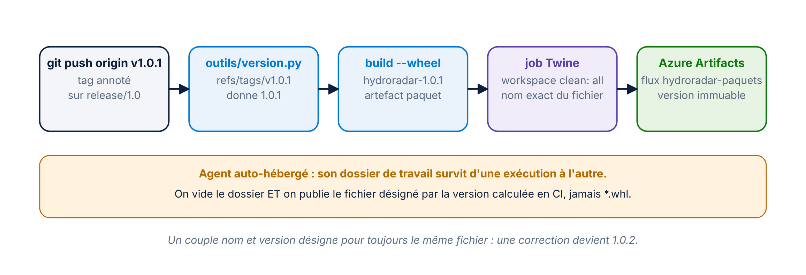

**A. Le flux.** **Artifacts > + Create Feed**, Visibility **Members of votre-organisation**, sources amont décochées, Scope **Project: HydroRadar**. Nom :

```
hydroradar-paquets
```

Dans **Feed settings > Permissions**, le **HydroRadar Build Service** est déjà présent, en **Feed and Upstream Reader (Collaborator)** : il peut lire, pas publier. Cochez sa ligne, **Edit**, rôle :

```
Feed Publisher (Contributor)
```

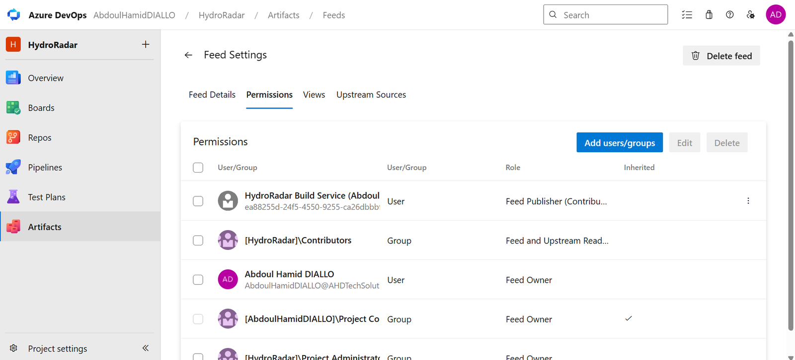

| Rôle | Droits |
|---|---|
| Reader | lire et télécharger |
| Collaborator | lire, plus enregistrer des paquets venus des sources amont |
| **Contributor (Publisher)** | **publier** : c'est le minimum pour le pipeline |
| Owner | tout, y compris les droits et la suppression |

**B. La branche de release et le tag.**

1. Passez la User Story **Release 1.0 et paquet dans Azure Artifacts** en **Active**.

2. Créez la branche **depuis l'interface** (la stratégie `release/*` impose les PR) : **Repos > Branches > New branch**, Based on **main**, work item lié, nom :

```
release/1.0
```

Elle porte aussitôt l'icône de stratégie.

3. En local :

```
git fetch
```

```
git switch release/1.0
```

4. Le tag **annoté** (auteur, date, message), puis son envoi :

```
git tag -a v1.0.0 -m "HydroRadar 1.0.0 : pipeline multi-environnements sur données réelles"
```

```
git push origin v1.0.0
```

Vérifiez que c'est bien un tag annoté (réponse `tag`, et non `commit`) :

```
git cat-file -t v1.0.0
```

5. Le pipeline démarre sur le tag : l'exécution s'appelle **1.0.0**, CI construit `hydroradar-1.0.0-py3-none-any.whl`, DEV et PROD sont ignorés, **Publication** envoie la wheel dans le flux.

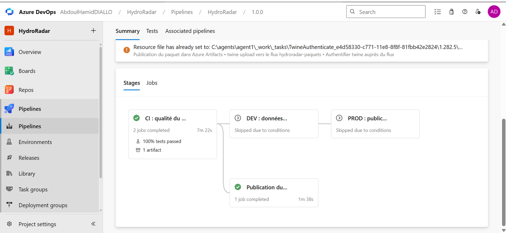

6. **Artifacts > hydroradar-paquets** : `hydroradar 1.0.0`. **Connect to feed > pip** donne l'URL d'index pour l'installer partout dans l'organisation. Passez la story en **Closed**.

7. **Préparez la version suivante sur `main`** : dans `src/hydroradar/__init__.py`, `__version__` passe à `1.1.0` (par une PR). Les exécutions de `main` produisent alors des versions `1.1.0.devNNN`, toujours supérieures à la release livrée.

> **Un paquet publié est immuable.** Le flux n'acceptera jamais une seconde version `1.0.0`, même après suppression (erreur **409 Conflict**). Toute correction devient `1.0.1`. De même, **un tag poussé ne se réécrit pas**.

> **Deux sortes d'artefacts.** L'**artefact de pipeline** (`publish:`) est attaché à une exécution et passe des fichiers entre stages. Le **paquet Azure Artifacts** vit dans un flux, versionné et durable.

---

# Phase 6. Maîtriser

## Étape 14. Une journée d'ingénieur

**Pourquoi.** Cette étape enchaîne ce qui arrive vraiment : vous commencez la documentation, une urgence tombe, vous la traitez sans perdre votre travail, puis vous reprenez. Passez la User Story **Documentation, wiki et journée Git** en **Active**.

### A. Commiter une partie de ses changements (`add -p`)

```
git switch main
```

```
git switch -c docs/wiki
```

Copiez [`docs/architecture.md`](architecture.md) et [`docs/exploitation.md`](exploitation.md). Dans `README.md`, modifiez **deux endroits éloignés** : juste **avant** `## Démarrage`, ajoutez

```
## Prérequis

Python 3.11 ou plus récent, Git 2.37 ou plus récent.
```

et tout **à la fin** du fichier :

```
## Documentation

Le dossier docs est publié en wiki dans Azure DevOps.
```

Deux commits distincts, même si tout a été modifié d'un coup :

```
git add docs
```

```
git add -p README.md
```

Au premier morceau (Prérequis), répondez `n` ; au second (Documentation), `y`. Vérifiez :

```
git diff --staged
```

```
git diff
```

Si l'affichage se termine par `:`, c'est le lecteur de pages : **Espace** pour avancer, **q** pour quitter.

```
git commit -m "docs: architecture et exploitation, publiées en wiki"
```

```
git add README.md
```

```
git commit -m "docs: prérequis du poste de travail"
```

### B. Annuler une modification locale (`restore`)

Ajoutez une ligne `test` à la fin de `docs\exploitation.md`, enregistrez, puis :

```
git add docs/exploitation.md
```

```
git restore --staged docs/exploitation.md
```

```
git restore docs/exploitation.md
```

```
git status
```

Le répertoire est propre. Attention : `restore` sans `--staged` efface **définitivement** la modification.

### C. Corriger un ancien commit (`--fixup` et autosquash)

Vous voulez compléter `docs\architecture.md`, introduit par le commit « docs: architecture… », qui n'est plus le dernier : `amend` ne suffit pas. Sous le titre `## Source des données`, ajoutez la ligne `Licence Ouverte Etalab, sans clé d'accès.` et enregistrez. Repérez le SHA du commit à corriger :

```
git log --oneline -3
```

Puis, en remplaçant `abc1234` par **le vrai SHA** affiché :

```
git commit -a --fixup abc1234
```

> **Piège PowerShell.** N'écrivez jamais un exemple du type `<sha>` tel quel : PowerShell lit `<` et `>` comme des redirections. Remplacez-le toujours par la valeur réelle.

```
git rebase -i main
```

L'éditeur s'ouvre avec la ligne `fixup` **déjà placée** sous le bon commit, grâce à `rebase.autosquash`. Enregistrez et fermez sans rien changer.

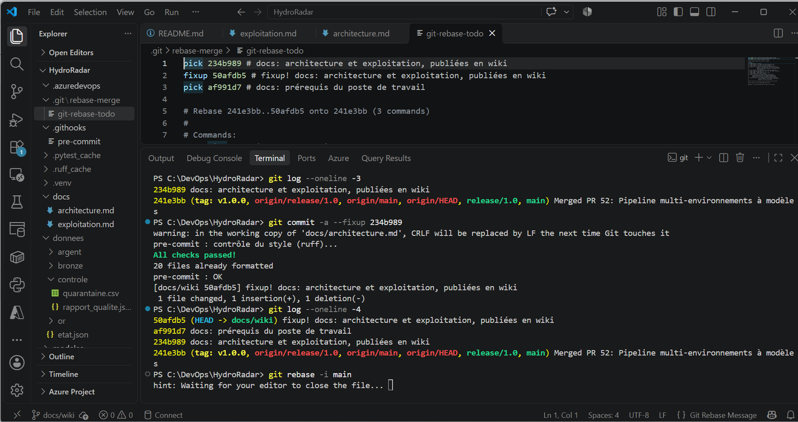

```
git log --oneline -3
```

Il ne reste que deux commits, avec de nouveaux SHA. Git refuse de lancer un rebase s'il reste des modifications non commitées : c'est une protection.

> **Règle d'or.** On ne réécrit que des commits **jamais partagés**. `amend` corrige le dernier commit ; `--fixup` + autosquash corrige n'importe quel commit local.

### D. Le hook refuse un commit sale

Ajoutez `import os` en **première ligne** de `src\hydroradar\indicateurs.py`, puis :

```
git commit -am "refactor: essai"
```

Le hook affiche `F401 os imported but unused` (et `E402` sur les imports suivants, car la docstring n'est plus en tête) et **refuse** le commit. Retirez la ligne :

```
git status
```

> **À savoir.** Un hook se contourne (`--no-verify`, et `cherry-pick` ne le lance pas). Il aide le développeur ; la vraie barrière reste la **Build Validation** de `main`.

### E. L'urgence : un hotfix traité dans un worktree

Le client s'annonce toujours `HydroRadar/1.0`, quelle que soit la version installée : le User-Agent est figé. C'est un bug.

1. **Boards > Work items > + New Work Item > Bug**. Titre :

```
Le User-Agent du client Hub'Eau n'indique pas la vraie version
```

Repro Steps :

```
Le client envoie toujours HydroRadar/1.0 quelle que soit la version installée.
```

Iteration **Sprint 2**, assigné à vous, **Save**, puis **State : Active** et **Save** (l'état Active n'est proposé qu'une fois le work item enregistré). Notez son **ID**, par exemple `28`.

2. Un **second dossier de travail**, sur une nouvelle branche issue de `main`, sans stash ni commit temporaire :

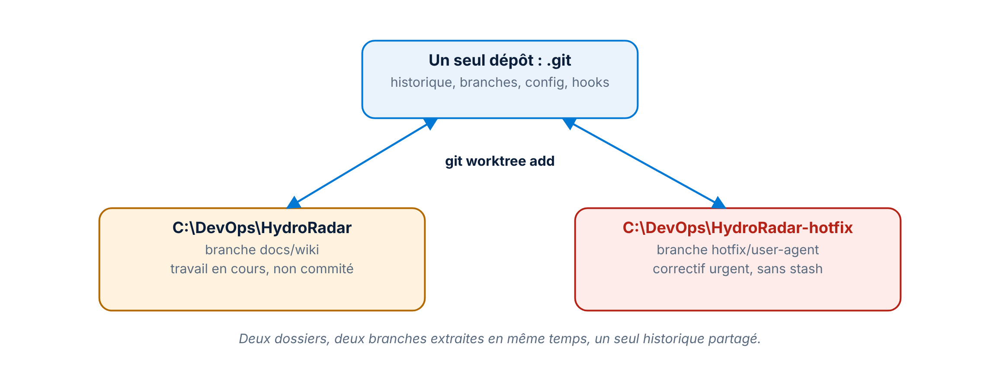

```
git worktree add ..\HydroRadar-hotfix -b hotfix/user-agent main
```

```
git worktree list
```

```
code ..\HydroRadar-hotfix
```

Dans la nouvelle fenêtre (barre du bas : `hotfix/user-agent`), ouvrez `src\hydroradar\client.py`. Sous `from urllib3.util.retry import Retry`, ajoutez **une ligne vide**, puis :

```
from hydroradar import __version__
```

Et remplacez la ligne du User-Agent, au **même niveau d'indentation** que `session.mount(...)` :

```
    session.headers["User-Agent"] = f"HydroRadar/{__version__} (projet Azure DevOps)"
```

Ajoutez à la fin de `tests\test_client.py` le test qui verrouille le correctif (le dernier test du fichier de ce dépôt), puis lancez les tests avec le Python du dossier principal :

```
..\HydroRadar\.venv\Scripts\python.exe -m pytest
```

Attendu : `rootdir: C:\DevOps\HydroRadar-hotfix` et `24 passed`. Si le hook signale `I001`, laissez ruff ranger les imports :

```
..\HydroRadar\.venv\Scripts\python.exe -m ruff check --fix .
```

3. Commit **avec l'ID du Bug** : `#28` relie le commit au work item.

```
git commit -am "fix(client): User-Agent avec la vraie version du paquet #28"
```

```
git push
```

> **`git push` n'envoie que des commits.** Si le hook a refusé le commit, le push crée une branche vide et la PR affichera « no changes to merge ». Vérifiez toujours `git status` avant de pousser.

4. PR **vers `main`** :

```
Hotfix : User-Agent avec la vraie version
```

Bug lié, **Set auto-complete** en Squash **sans** cocher la clôture des work items (le correctif doit encore aller dans la release), **Approve**. Après la fusion, approuvez **PROD**.

5. **Recopier le correctif dans la release** :

```
git fetch
```

```
git log --oneline -1 origin/main
```

La ligne doit être « Merged PR … Hotfix : User-Agent… ». Puis :

```
git switch -c hotfix/user-agent-1.0 origin/release/1.0
```

```
git cherry-pick -x origin/main
```

```
git log -1
```

Le `-x` ajoute `(cherry picked from commit …)` au message : la traçabilité entre les deux branches est écrite dans l'historique.

Cette branche suit `origin/release/1.0` (elle en est issue). Un simple `git push` tenterait d'écrire dans la release ; poussez vers une branche **du même nom** :

```
git push -u origin hotfix/user-agent-1.0
```

N'utilisez jamais `git push origin HEAD:release/1.0` : ce serait contourner la PR.

6. PR **vers `release/1.0`**. Azure DevOps propose **toujours** `main` comme cible : cliquez sur `main` et choisissez **release/1.0**, puis vérifiez la ligne `hotfix/user-agent-1.0 into release/1.0`, avec **Files 2** et **Commits 1**. Titre :

```
Hotfix 1.0.1 : User-Agent avec la vraie version
```

Bug lié, Squash, et cette fois **cochez** « Complete associated work items ».

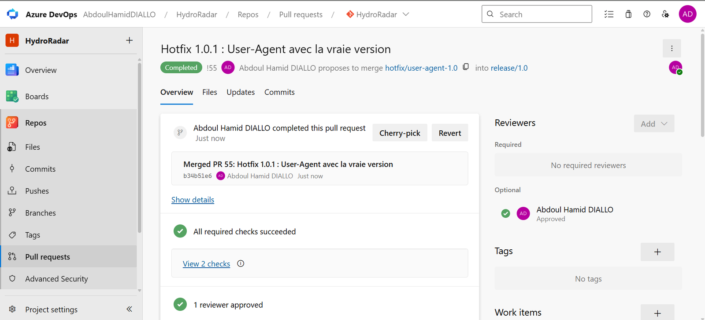

7. La version corrective :

```
git switch release/1.0
```

```
git pull
```

```
git log --oneline -2
```

En haut, « Merged PR … Hotfix 1.0.1 », juste au-dessus du tag `v1.0.0`. Alors seulement :

```
git tag -a v1.0.1 -m "HydroRadar 1.0.1 : User-Agent avec la vraie version"
```

```
git push origin v1.0.1
```

Le flux contient `1.0.1` et `1.0.0`.

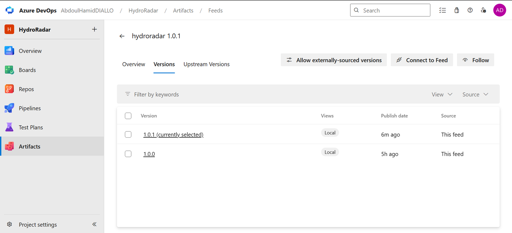

8. Rangez le worktree : fermez la fenêtre VS Code `HydroRadar-hotfix` (une fenêtre ouverte verrouille les fichiers sous Windows), puis, depuis `C:\DevOps\HydroRadar` :

```
git worktree remove ..\HydroRadar-hotfix
```

```
git branch -D hotfix/user-agent hotfix/user-agent-1.0
```

9. **Clore le Bug.** Une PR fusionnée le met en **Resolved / Fixed**. Une fois le correctif livré **partout** (`main`, production, release, paquet), passez-le en **Closed** : la raison devient **Verified**. Laissez un commentaire qui résume les PR et les versions concernées.

### F. Reprendre sa branche et la livrer

```
git switch docs/wiki
```

```
git fetch
```

```
git rebase origin/main
```

```
git push
```

PR **vers `main`** :

```
Documentation et wiki
```

User Story liée, auto-complete **sans** clôture, **Approve** (l'auto-complete attend votre approbation), puis approuvez PROD. Enfin :

```
git switch main
```

```
git pull
```

```
git branch -D docs/wiki
```

### G. Publier le dossier docs en wiki

**Overview > Wiki > Publish code as wiki** : Repository **HydroRadar**, Branch **main**, Folder `/docs` (bouton **...**), nom :

```
HydroRadar.wiki
```

Ne choisissez pas **Create project wiki** : il créerait un wiki séparé du code, modifiable sans revue.

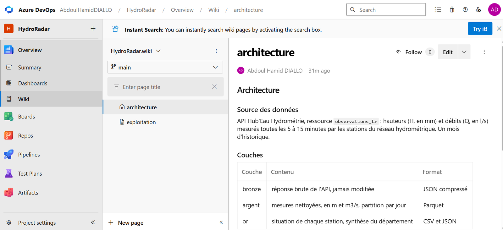

Le wiki **lit** la branche `main` : chaque PR qui modifie `docs` le met à jour. C'est la documentation as code.

### H. Trouver le commit coupable (`bisect`)

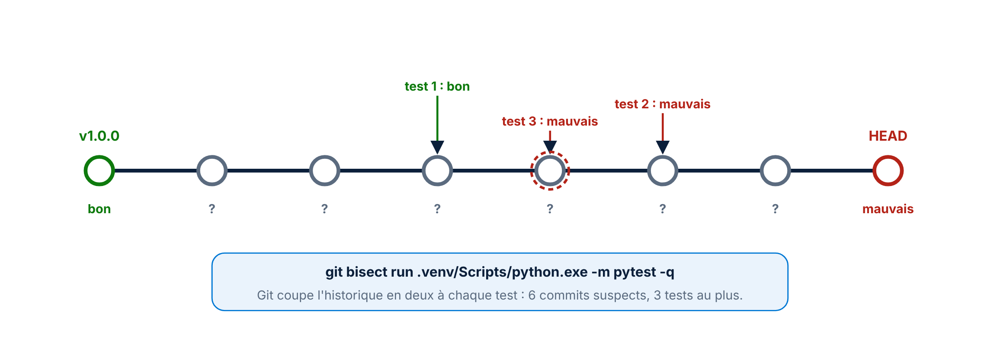

Dans un bac à sable local, **jamais poussé** :

```
git switch -c bac-a-sable/bisect
```

```
Add-Content README.md "Note 1"
```

```
git commit -am "docs: note 1"
```

```
Add-Content README.md "Note 2"
```

```
git commit -am "docs: note 2"
```

Le commit fautif : dans `src\hydroradar\transformation.py`, sur la ligne `UNITES`, remplacez le premier `1000.0` (celui de `"H"`) par `100.0`.

```
git commit -am "refactor: simplifie les unités"
```

```
Add-Content README.md "Note 3"
```

```
git commit -am "docs: note 3"
```

```
Add-Content README.md "Note 4"
```

```
git commit -am "docs: note 4"
```

```
git bisect start
```

```
git bisect bad
```

```
git bisect good v1.0.0
```

```
git bisect run .venv/Scripts/python.exe -m pytest -q
```

Git teste lui-même le milieu de l'intervalle et annonce `… is the first bad commit` : **refactor: simplifie les unités**. Les tests sur données réelles le prouvent : 2,162 m deviennent 21,62 m.

```
git bisect log
```

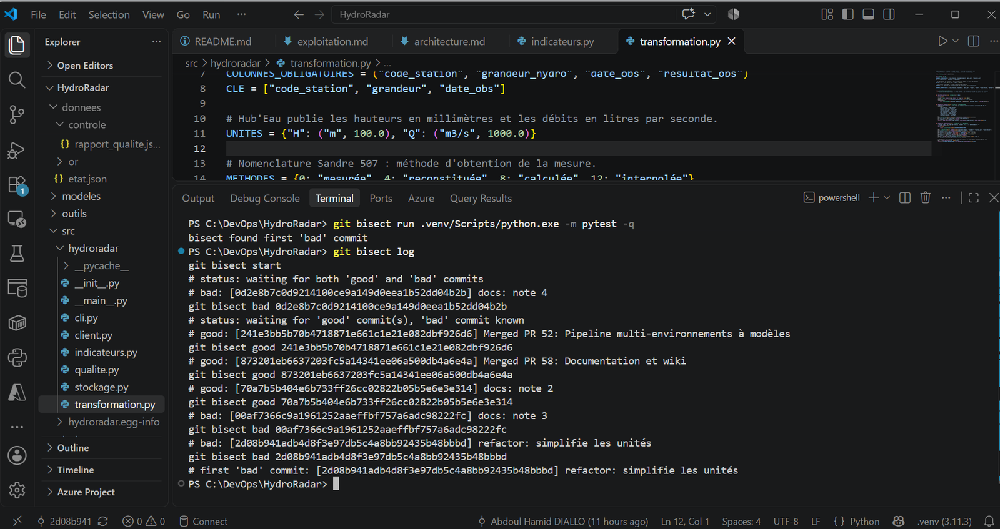

```
git bisect reset
```

```
git switch main
```

```
git branch -D bac-a-sable/bisect
```

### I. L'archéologie : les commandes d'enquête

| Question | Commande |
|---|---|
| Quand ce mot est-il apparu ou parti ? | `git log -S RECOUVREMENT --oneline` |
| Toute l'histoire d'un fichier | `git log --oneline --follow -- src/hydroradar/client.py` |
| Qui a écrit ces lignes ? | `git blame -L 40,50 src/hydroradar/client.py` |
| Ce que la release a, et pas `main` (par SHA) | `git log --oneline main..origin/release/1.0` |
| Le même correctif est-il déjà dans `main` (par contenu) ? | `git cherry -v main origin/release/1.0` : `-` = déjà présent |
| Où en est la release par rapport aux versions ? | `git describe --tags origin/release/1.0` : par exemple `v1.0.1-1-g41a9fd9` |
| Le contenu d'une version | `git show v1.0.0 --stat` |
| Qui a commité combien ? | `git shortlog -sn` |
| Que supprimerait `git clean` ? | `git clean -n -d` (`-n` = simulation) |

Si `git shortlog -sn` montre deux orthographes de votre nom, ajoutez à la racine un fichier `.mailmap` (par une PR) :

```
Prénom NOM <adresse@exemple.com> Prénom Nom <adresse@exemple.com>
```

**Clôturez dans Boards, du bas vers le haut** : la User Story, puis la Feature, puis l'Epic. Pour tout voir d'un coup : **Boards > Backlogs**, niveau **Epics**, **Options d'affichage** (icône curseurs) > **Completed Child Items : On**, bouton **⊞** pour tout déplier, et **Column Options > + Add a column > State**.

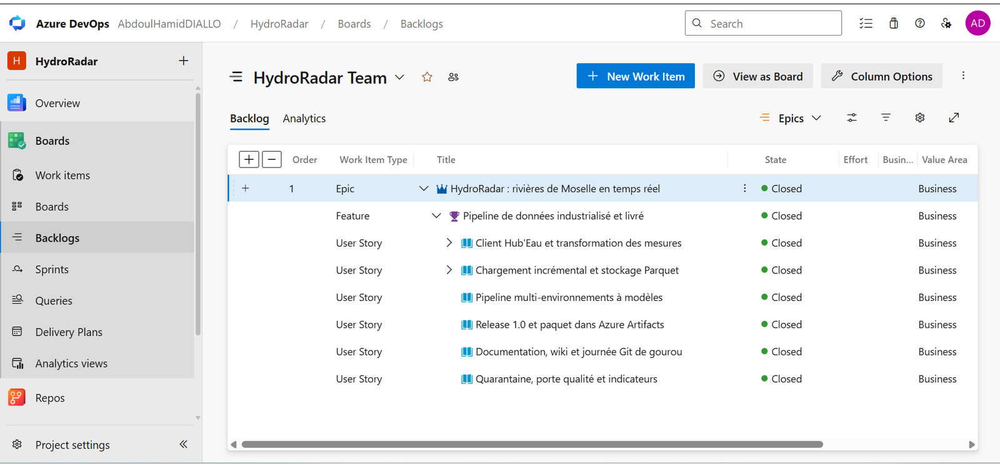

## Étape 15. Le tableau de bord

**Overview > Dashboards**, tableau de l'équipe, **Edit**, **+ Add Widget**. Pour chaque widget : glissez-le, cliquez sa **roue dentée**, réglez, **Save**.

| Widget | Titre | Réglage |
|---|---|---|
| **Build History** | `Historique des exécutions` | pipeline HydroRadar, toutes les branches |
| **Test Results Trend** | `Tendance des tests` | Build, pipeline HydroRadar |
| **Sprint Burndown** | `Burndown du sprint` | **Stories backlog**, **Count of work items** |
| **Query Tile** | `Travail du sprint` | requête **Travail du sprint en cours**, règle : orange si > 0 |

**Done Editing**. Dans Build History, chaque barre est une exécution, sa hauteur est sa durée (attente d'approbation comprise), sa couleur son résultat.

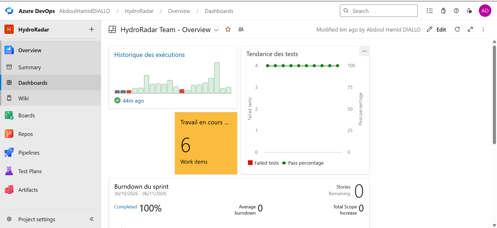

## Étape 16. Tout arrêter : zéro consommation

1. **Pipelines > HydroRadar > ...** > **Settings** > **Processing of new run requests : Disabled** > **Save**. **Disabled** refuse les nouvelles demandes ; **Paused** les accepterait en file, et elles partiraient toutes à la reprise.

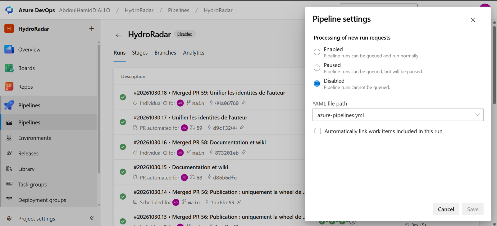

2. Dans la fenêtre de l'agent : **Ctrl+C**, puis répondez **O** à « Terminer le programme de commandes ». L'agent passe **Offline**. Laissez-le **Enabled** dans le pool : il reprendra du travail dès sa relance.

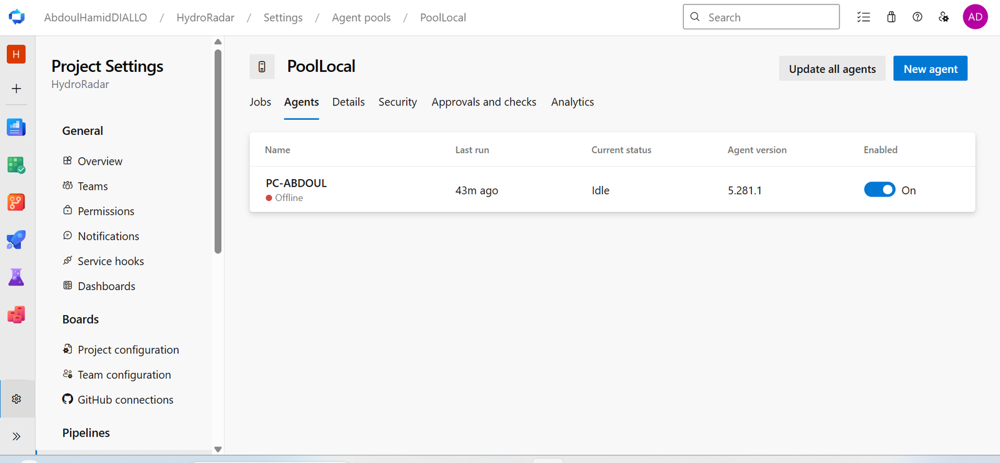

3. Rien d'autre à éteindre : aucune ressource Azure n'existe.

Pour reprendre : pipeline en **Enabled**, puis

```
cd C:\agents\agent1
```

```
.\run.cmd
```

---

# Annexe A. Antisèche d'entretien

| Question | Réponse courte |
|---|---|
| Les trois syntaxes de variables ? | `${{ }}` compilation (structure) ; `$[ ]` exécution (conditions, sorties) ; `$( )` macro avant chaque étape |
| Modèle (template) ? | YAML réutilisable de steps, jobs, stages ou variables ; `extends` impose une structure obligatoire |
| Paramètre ou variable ? | paramètre typé, connu à la compilation ; variable texte, modifiable à l'exécution, éventuellement secrète |
| Passer une valeur entre stages ? | `##vso[task.setvariable variable=x;isOutput=true]` dans une étape nommée, puis `stageDependencies.Stage.Job.outputs['etape.x']` |
| Où mettre un secret ? | groupe de variables (cadenas), idéalement relié à Key Vault ; dans un script, seulement via `env:` |
| Environment et checks ? | cible de déploiement avec historique ; ses contrôles sont hors du YAML, donc incontournables |
| Build once, deploy many ? | un seul paquet construit en CI, installé tel quel en DEV puis en PROD |
| Agent auto-hébergé : le piège ? | son dossier de travail survit entre exécutions : `workspace: clean: all` et jamais de joker pour publier |
| Paused ou Disabled ? | Paused met en file ; Disabled refuse |
| Artefact de pipeline ou Azure Artifacts ? | fichiers d'une exécution, ou paquets versionnés dans un flux |
| SemVer ? | MAJEUR.MINEUR.CORRECTIF ; un hotfix donne `1.0.1` |
| Un hotfix, dans quel ordre ? | `main` d'abord, puis `cherry-pick -x` dans la release, puis tag correctif |
| Trouver le commit qui a cassé ? | `git bisect run <test>` : environ log2(n) tests |
| worktree ou stash ? | stash met de côté dans le même dossier ; worktree ouvre une seconde branche dans un second dossier |
| Corriger un vieux commit ? | `--fixup <sha>` puis `rebase -i --autosquash`, sur une branche non partagée |
| Hook ou CI ? | le hook aide et se contourne ; la CI imposée par stratégie est la barrière |
| Tag léger ou annoté ? | annoté (`-a`) pour une version : auteur, date, message ; vérifier avec `git cat-file -t` |
| Chargement incrémental ? | filigrane, recouvrement, fusion idempotente ; le filigrane n'avance que si le lot est accepté |
| Bronze, argent, or ? | brut immuable ; nettoyé et typé ; agrégé pour le métier |
| Resolved ou Closed ? | Resolved : corrigé par le développeur ; Closed / Verified : livré et constaté partout |

# Annexe B. Glossaire

| Terme | Définition |
|---|---|
| Sprint (iteration) | période à dates fixes |
| Story Points | estimation relative de l'effort |
| Burndown | courbe du travail restant |
| Macro de requête | `@CurrentIteration`, `@Me`, `@Today` |
| PR brouillon | PR visible mais pas encore soumise à revue |
| Auto-complete | fusion automatique dès que les stratégies sont satisfaites |
| Stratégie par motif | règle appliquée à toutes les branches d'un motif (`release/*`) |
| Hook | script lancé par Git à un moment précis |
| Hunk | morceau de différence |
| Fixup / autosquash | commit de correction, rangé automatiquement au rebase |
| Worktree | dossier de travail supplémentaire lié au même dépôt |
| Bisect | recherche dichotomique d'un commit |
| Pioche (`log -S`) | recherche des commits qui ajoutent ou retirent un texte |
| Modèle YAML | fragment de pipeline réutilisable |
| Variable de sortie | variable publiée par une étape pour la suite |
| Commande de journalisation | ligne `##vso[...]` interprétée par l'agent |
| Contrôle de branche | check d'environnement limité à certaines branches |
| Flux (feed) | dépôt de paquets Azure Artifacts |
| Wheel | paquet Python prêt à installer |
| Filigrane | dernière position chargée |
| Upsert | insertion ou mise à jour selon la clé |
| Élagage de partitions | lecture des seules partitions utiles |
| Contrat de schéma | colonnes exigées de la source |

# Annexe C. Dépannage

| Symptôme | Cause et solution |
|---|---|
| « needs permission to access a resource » | **View > Permit** sur l'exécution, ou **Pipeline permissions** dans la ressource |
| `FileNotFoundError` sur les données de test en CI | le `.gitignore` ignore `tests/donnees` : écrivez `/donnees/` ; diagnostic `git check-ignore -v` |
| DEV ou PROD « Skipped » | vous n'êtes pas sur `main` (PR, branche ou tag) : voulu |
| PROD absent du graphe | lancé avec **Inclure le déploiement en production** décoché |
| « Expecting team value » dans une requête | choisissez l'équipe dans la seconde case de `@CurrentIteration` |
| PR bloquée « At least 1 reviewer » | cochez **Allow requestors to approve their own changes** et cliquez **Approve** |
| PR « There are no changes to merge » | la branche poussée ne contient pas de commit (commit refusé par le hook) |
| `src refspec main does not match any` | aucun commit n'existe encore : committez avant de pousser |
| `fatal: The upstream branch … does not match` | branche créée depuis `origin/release/1.0` : `git push -u origin <nom-de-branche>` |
| L'opérateur `<` est réservé (PowerShell) | remplacez l'exemple `<sha>` par la vraie valeur |
| Publication « 403 Forbidden » | le Build Service n'est pas **Feed Publisher** du flux |
| Publication « 409 Conflict » | cette version existe déjà : nouveau tag, nouvelle version |
| `IndentationError: unexpected indent` | ligne collée avec des espaces en trop : alignez-la sur ses voisines |
| Le hook échoue avec `I001` | `ruff check --fix .` range les imports |
| La porte qualité refuse | artefact `controle-…`, `rapport_qualite.json`, cherchez `"ok": false` ; le filigrane n'a pas bougé |
| « Free memory is lower than 5% » | l'agent tourne sur un PC chargé : fermez des applications |
| `git bisect run` ne trouve pas Python | barres obliques `/` dans le chemin |
| `git worktree remove` refuse | fermez la fenêtre VS Code du worktree, commitez ou jetez les modifications |
| Un rebase tourne mal | `git rebase --abort` ramène à l'état d'avant |
